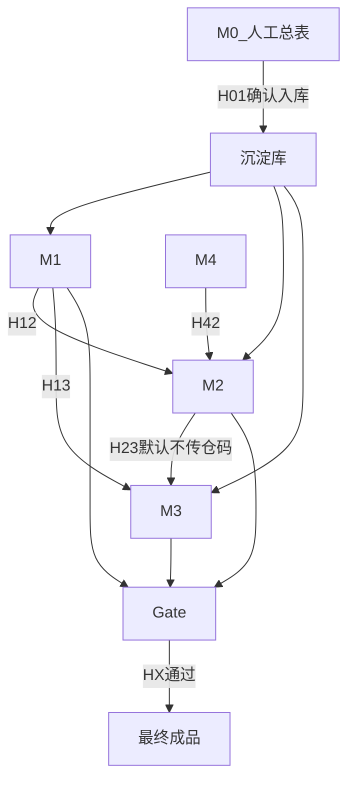

# AutoExport 业务模块与握手规则（办公室端）

> 与 [.cursorrules](../.cursorrules) 同步。云端部署名：**AutoExport**。本机：`D:\.cursor\Cursor-projects\AutoExport`。

## 模块一览

| ID | 名称 | 职责 |
|----|------|------|
| M0 | 总表/沉淀 | 人工总表或单据提炼 → **确认后**写入沉淀库 |
| M1 | 订单+出货 | C04/C07 品牌、装箱、FNSKU；产出订单/出货草稿 |
| M2 | 货代下单 | 明细 + 仓头（待 H42） |
| M3 | 报关 | 申报口径；可延期 |
| M4 | FBA 入库仓 | Shipment / 仓库代码 |
| Gate | 交叉对照 | 对照沉淀库；通过才最终输出 |

## 握手契约

| ID | 方向 | 必须携带 | 约束 |
|----|------|----------|------|
| **H01** | → M0 / 沉淀 | `confirmed_by_user=true` | 未确认不得入库、不得当对照权威 |
| **H12** | M1 → M2 | 品牌、FNSKU、箱数、条数/箱、外箱、订单参考号 | 禁止串店 FNSKU；装箱冲突走 §1.1 |
| **H42** | M4 → M2 | 仓库代码、FBA 货件号、地址头 | 无仓则标「待入库货件」 |
| **H13** | M1 → M3 | 件数、毛净重、品名规格 | 金额≠采购底价 |
| **H23** | M2 → M3 | 默认无 | 仓码/FBA 号默认不进报关 |
| **HX** | 草稿 → Gate | 主体品牌、FNSKU、装箱勾稽、多单一致 | 失败阻断最终输出 |

## 云端落地对照

| 能力 | 位置 |
|------|------|
| 进度树（仅后台） | `web/app/admin/progress` |
| **FBA 仓头识别 + 追踪码** | `web/app/admin/fba-track` + `POST/GET /api/fba-track` + `PATCH /api/fba-track/update` |
| H01 总表导入 | `web/app/admin/master-import` + `POST /api/master-import` |
| Schema | `supabase/migrations/`（含 `fba_warehouse_headers`） |
| Vercel | Root Directory = `web`；见 `docs/VERCEL.md` |
