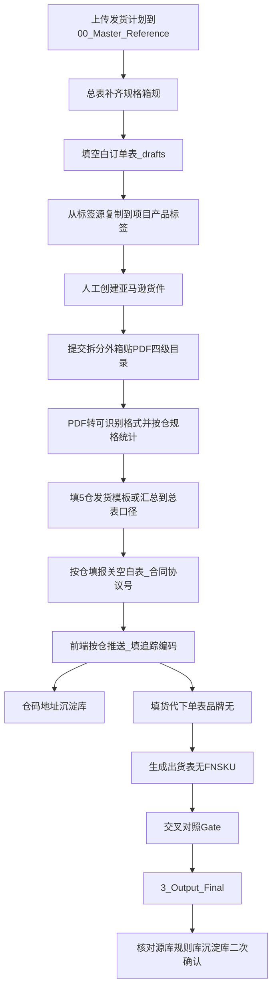

# AutoExport — 端到端发货流水线（工作流与字段定义）

> 状态：规则与顺序已按业务口述固化；实现按阶段推进。  
> 业务根：`D:\.cursor\Cursor-projects\AutoExport`  
> 旁注：同级 `_workspace_archive_AutoExport_20260720` 仅为 Cursor 元数据归档，见 [`docs/WORKSPACE_ARCHIVE.md`](../docs/WORKSPACE_ARCHIVE.md)。

## 0. 目录约定

| 用途 | 路径 |
|------|------|
| 总表 + **发货计划（演进中）** | `1_Input_Raw/00_Master_Reference/` |
| 总表文件 | `2026.7.20桌布当前产品总表.xlsx`（及后续版本） |
| 一票发货项目 | `1_Input_Raw/Shipments/{订单号}_{店铺}_{出货日}_{条数}/` |
| 当票订单源（近端） | 项目内 `订单表/`（使用者指定时以此为准） |
| 最终成品 | `3_Output_Final/{同一项目名}/`（须 Gate） |
| 草稿 | `2_Processed_AI/drafts/` |
| 标签源库 | `1_Input_Raw/00_Master_Reference/桌布标签`（绝对路径见 §3）；项目内 `产品标签/` 为当票副本 |

日常不以 `01/02/03` 为归类主轴。

### 0.1 发货计划输入形态（2026-07-20 约定）

| 阶段 | 形态 | 说明 |
|------|------|------|
| **近端（当前）** | 仍用过去手工流程；**尚无**标准「发货计划表」 | 当票常为 **一单一票**；规格/箱数以该票订单（或口述/临时表）为准，再调总表补齐箱规 |
| **远期（拟）** | 在 **总表** 上为每次发货 **单独加一列** | 列语义：`{发货批次名}` → 各 FNSKU 行填 **箱数**（某某 FNSKU 多少箱）；空=本票不发 |

近端不阻塞：无标准计划表时，流水线入口可为「订单行 + 总表 join」，不强制先有计划 xlsx。  
远期列名/批次命名规则落定后再写解析器；落定前不得臆造列格式写死代码。

---

## 1. 规格键与对应关系（核心）

发货计划行用下列字段确定一票规格：

| 字段 | 作用 |
|------|------|
| 店铺代码（C04/C07） | 主体 / 店铺 |
| 品牌名 | C04→WIGENIUS；C07→Dressmaker（计划可写，须与店铺一致） |
| 克重 | 默认 **90G**；其它当票确认 |
| 尺寸 | 短码↔全称已确认（`size_shortcode_map`；120=70X120inch） |
| 颜色 | |
| 每包条数 | |
| **FNSKU** | 由上列决定；确定后 **外包装 + 箱规** 由总表对应行锁定 |
| 箱数 | 本计划该规格发货箱数 |

**查找顺序**

1. 有 FNSKU → 总表按 FNSKU 取装箱/内外箱/净毛重/1039 单价/HS  
2. 无 FNSKU → 用 `店铺+品牌+克重+尺寸+颜色+每包条数` 匹配总表，回填 FNSKU 与箱规  
3. 冲突或多版本 → **汇报**，不静默选用（装箱冲突默认建议：最新 `order_date` / 总表 `master_upload_at` + 90G）

已确认默认：`hs_code=6302539090`；货代品牌列=`无`；出货表不写 FNSKU；订单=EF 长号、出货=短号。

---

## 2. 阶段流水线（先后顺序）



### 阶段明细

| 步 | 名称 | 输入 | 输出 | 闸门 |
|----|------|------|------|------|
| P1 | 计划/订单入库 | **近端**：工厂订单（或临时明细）；**远期**：总表发货列（FNSKU×箱数） | 规范化计划行（canonical） | 列齐全或可从总表补 |
| P2 | 总表补齐 | 计划/订单行 + 总表 | 完整行（FNSKU、箱规、净毛重、1039…） | 冲突汇报；H01 沉淀仍 **WAIT** 至口头确认 |
| P3 | 订单生成 | 补齐行 + `Templates/order_blank_zh.xlsx` | 项目 `订单表/` 草稿 → Gate → Final | C04 页眉不写畅选 |
| P4 | 标签复制 | FNSKU / 计划行 + **标签源** | 项目 `产品标签/`（**仅复制**） | 见 §3 双确认；事后核对源未变 |
| P5 | 人工货件 | 外箱贴 + 计划截图 | 亚马逊侧 通常约 5 仓（可 1 或 >5） | |
| P6 | 外箱贴目录 | 用户提交 PDF | 四级结构解析 | 见 §4 |
| P7 | 仓规格统计 | 解析结果 | 仓 × 规格 → 箱数；总净/毛重、总报关金额、总箱/条、平均单价 USD | 见 §5 金额规则 |
| P8 | 报关 | 仓汇总 + 报关空白表 | 项目 `报关资料表/`；文件名含合同协议号 | 协议号：`YYYYMMDD`+三位随机；**同计划不同目的地号不同**；其它栏位保持模板不变 |
| P9 | 前端仓头 | 按目的仓 / FBA 单号 | 总件数、总条数、平均单价、FBA 单号、仓库代码；追踪码人工填 | 识别不到 FBA 单号则空出手工填 |
| P10 | 仓址沉淀 | 确认后的仓码↔地址 | **独立** FBA 仓库库（非产品沉淀主库） | 写入须确认 |
| P11 | 货代下单 | 仓头 + 明细；品牌=`无` | `货代入库贴下单表/` | H42 仓头齐后再写满 |
| P12 | 出货表 | 计划/订单短号口径 | `出货表/` **无 FNSKU** | |
| P13 | Gate + 终审 | 草稿 vs 权威参考 | `3_Output_Final/{项目}/` | 失败阻断 |
| P14 | 库核对 | 源文件 / 规则 / 对应关系 / 沉淀 | 变更清单交使用者 **两次确认** | |

---

## 3. 标签源闸门（强制）

| 规则 | 要求 |
|------|------|
| 定位 | 标签源 = **核心库**；助手只复制出/调取；**禁止**对源增删改；仅你经手动上传路径可增删源 |
| 复制前 | 统计数量+格式，与 **上次完工** `last_completed.json` 核对 |
| 复制后 | 再统计，须与 **本次复制前** 一致 |
| 当票结构（**固定**） | `{EF订单号}标签/{N}条装/{尺寸短码}/原名.pdf`（见 [`Shipment_Product_Label_Layout.md`](Shipment_Product_Label_Layout.md)） |
| 路径 | `D:\.cursor\Cursor-projects\AutoExport\1_Input_Raw\00_Master_Reference\桌布标签` |

规则文件：`.cursor/rules/label-source-gate.mdc`（alwaysApply）。

---

## 4. FBA / AWD / GWD 外箱贴目录与渠道识别

发往亚马逊相关仓分渠道：**FC（运营中心）**、**AWD**、**GWD（预留）**。外箱贴大同小异，须先识别渠道再拆分归纳。全文：[`Carton_Label_Channels.md`](Carton_Label_Channels.md)。

流水线：`[可选清洗] → [可选转格式] → **识别版式 + 按版式确认字段** → 分离 → 同仓同规格合并多页PDF → 归纳`。  
拆分与合并目的相同（识别 + 工厂贴标）；**区分点是 FC/AWD 版式字段表**，见 [`Carton_Label_Channels.md`](Carton_Label_Channels.md) §3。

```text
FBA外箱贴/
  FC|{AWD}|{GWD}/
    {仓库代码}/
      {规格夹}/
        *.pdf                          # 一箱一文件优先
```

兼容旧树（仓码直接挂在 `FBA外箱贴/` 下）= 默认按 **FC** 解析。

**对应关系**：`货件号` ↔ `仓库代码` ↔ `追踪编码` ↔ **`channel`**。

每箱仅一个 SKU（卖家 SKU / FNSKU 以沉淀为准）。

---

## 5. 金额与重量汇总规则

按 **目的仓**（或填入「亚马逊 5 仓产品发货模板」/总表口径）汇总：

- 总净重、总毛重、总报关金额、总箱数、总条数  
- `平均单价_USD = round(总报关金额 / 总条数, 2)`  
- 复核：`平均单价 × 总条数`；若与原总报关金额不符，**以 总条数 × 平均单价 为准** 回写总价  
- 货代下单：**一仓一行综合**（总箱+总条）；单价/总价同上正算反算  
- C04 报关 1039（**所有后续票**）：**表内抬头**=许昌波丽丝贸易有限公司；**文件名**可含「畅选+波丽丝」等（**禁止把文件名叫抬头**）；内部主体畅选不全称进表内抬头格；**不退税，只免征**；表内主要变文件名/件数/成交数量/单价/货值/净毛重合计  

重量两位、金额两位、体积三位（全局规则）。

### 5.0 规格汇总 ↔ 分仓汇总对照（强制 · 2026-07-22）

每次算货值/毛净重必须做 **两套算法对照** 并写入当票工作记录（见 [`Amount_Weight_Reconcile.md`](Amount_Weight_Reconcile.md)）：

| 算法 | 做法 | 用途 |
|------|------|------|
| **A 规格汇总** | Σ(各规格总箱 × 总表每箱单价/净重/毛重) | 对照基准（误差率分母） |
| **B 分仓汇总** | 每仓先 Σ(箱×单价/重量)；**货值**再正算反算 | **落表权威** |

**误差率闸门**（下一步依据）：

```text
误差率 = |B − A| / A × 100%   （货值、净重、毛重分别算）
≤ 1% → 正常误差，无需向使用者报告，继续
> 1% → 须人工确认后才能继续
```

落表货值用 B；毛净重用 B（应与 A 接近）。本票 C26079-A 货值误差率 ≈ 0.073%（通过）。
### 5.1 拆单腿标识（P12 出库 / 分批发货）

同一 EF 订单分多批发货时，各批在**出货短号**同一 stem 下用字母腿区分，默认依次为 **`C26079-A` / `C26079-B` / `C26079-C`**（首批发默认 **`-A`**）。

- 项目内 `拆单比对/` 下各批 manifest 模板须含顶层字段 **`split_leg_id`**（紧跟 **`batch_no`** 之后）。
- 计划条数 / 已发 / 剩余对账与命名约定见 [`Split_Shipment_Ledger.md`](Split_Shipment_Ledger.md)；台账脚本 `Scripts/07_split_shipment_ledger.py`。
- P12 出库表按当批 **`split_leg_id`** 落盘，**不含 FNSKU**（与 §4.1 一致）。


---

## 6. 与现有模块握手

| 步 | 模块 |
|----|------|
| P2 总表 | M0；H01 入库仍 WAIT |
| P3/P12 | M1 |
| P11 | M2；品牌=`无` |
| P8 | M3 |
| P6–P10 | M4 + 仓址独立库 |
| P13 | Gate HX |

Canonical keys：[`Canonical_Data_Schema.md`](Canonical_Data_Schema.md) / `Scripts/canonical_schema.json`。

---

## 7. 实现顺序（代码 / UI / 发布）

1. **规则落地**：本文件 + 标签源闸门 mdc（路径填入后）+ Correspondence 增量  
2. **脚本**：计划解析 → 总表 join → 订单（已有 `05_generate_order.py` 延伸）→ 标签复制校验 → FBA PDF 统计 → 报关/货代/出货填表 → Gate  
3. **UI**：简洁干练、温暖；仓头推送 + 追踪码填写 + 异常空行手工补  
4. **交付确认** → 再 GitHub → Vercel（`ship-github-vercel`；未确认不 push）

---

## 8. 待你补充才能编码的项

| 项 | 状态 |
|----|------|
| 标签源绝对路径 | **已指定** → `00_Master_Reference/桌布标签` |
| 标准发货计划表 | **近端无**；用手工商单/订单驱动。远期：总表加发货列（FNSKU×箱数），列名规则待定 |
| 本次具体订单号 / 项目夹 | 当票告知 |
| 亚马逊 5 仓空白模板 xlsx | 放入 `Templates/` 或指定样例路径 |
| 报关 / 货代空白骨架 | 优先用 Shipments 已验证样例抽模板 |
| 尺寸短码↔全称 | **已确认** 见 `size_shortcode_map`（120=70X120inch） |
| H01 产品总表入库 | 仍 WAIT（等你口头确认再写入沉淀库） |
